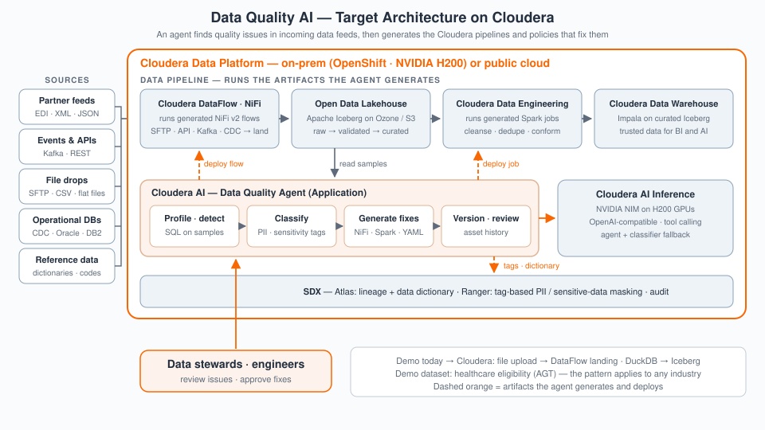

# Cloudera Blueprint: Agentic Data Quality

[](NOTICE.txt)
[](app/backend/requirements.txt)
[](METADATA.yaml)
[](https://github.com/cloudera-applied-ai/AI_Blueprint_Agentic-Data-Quality/stargazers)
[](https://github.com/cloudera-applied-ai/AI_Blueprint_Agentic-Data-Quality/network/members)

> Agentic data-quality assistant for healthcare member eligibility (AGT) data on **Cloudera AI**: profile and classify columns, detect issues, and generate **NiFi v2**, **CDE Spark**, and **YAML** remediation artifacts from chat — powered by **Cloudera AI Inference** and governed pipeline components.

## Table of Contents

- [Overview](#overview)
- [Demo](#demo)
- [Use Case](#use-case)
- [Key Features](#key-features)
- [Quickstart / Guide](#quickstart--guide)
- [Architecture / Software Components](#architecture--software-components)
- [Target Audience](#target-audience)
- [Repository Structure](#repository-structure)
- [Prerequisites](#prerequisites)
- [Hardware Requirements](#hardware-requirements)
- [Documentation](#documentation)
- [License](#license)

## Overview

Healthcare Data Quality AI is an agentic data-quality assistant for healthcare member
eligibility (AGT) data, built to run on Cloudera AI (CML) as a launchable AMP. It loads
pipe-delimited AGT files into DuckDB, profiles and classifies every column (three bundled
sklearn classifiers with an LLM fallback), detects quality issues, and lets an LLM-powered
chat agent generate the remediation artifacts — Apache NiFi v2 flows, CDE Spark jobs, and
YAML metadata dictionaries — directly from conversation. It demonstrates how Cloudera AI
Inference, Cloudera DataFlow (NiFi), and Cloudera Data Engineering (Spark) combine into an
end-to-end, governed data-quality remediation workflow.

## Demo

Reprise demo: https://app.getreprise.com/present/BXZ79wy 

Local demo material: sample AGT field metadata ships in `app/backend/AGT_metadata.json`.

## Use Case

Healthcare payers receive member eligibility feeds (AGT files) whose quality issues —
invalid codes, malformed phone numbers, length violations, corrupted and blank fields —
break downstream enrollment and claims processing. Finding those issues and hand-writing
remediation pipelines is slow, specialist work. This blueprint compresses that cycle: an
analyst uploads a feed, reviews automated profiling and sensitivity/semantic classification,
asks the agent what is wrong, and walks away with versioned, deployable NiFi flows and CDE
Spark jobs that quarantine, correct, or reject bad records — turning days of pipeline
authoring into a chat session.

## Key Features

- **Agentic chat over your data** — a streaming (SSE) tool-calling LLM agent that runs SQL,
  profiles columns, detects quality issues, and generates remediation artifacts on request.
- **Automated column profiling and classification** — value distributions, null rates, and
  pattern detection, plus semantic-type, format, and sensitivity classification via three
  bundled sklearn models with an LLM fallback.
- **Remediation artifacts, not just findings** — generates Apache NiFi v2 `VersionedDataflow`
  JSON, CDE Spark (PySpark) job definitions, and YAML data dictionaries, all saved with full
  version history.
- **Bring your own LLM** — works with Cloudera AI Inference, Ollama, or any OpenAI-compatible
  endpoint; provider settings are managed in the UI, never committed.
- **Deploys three ways** — one-click CML AMP, plain local Python, or Docker Compose (with an
  optional bundled Ollama profile).

## Quickstart / Guide

1. Clone the repository.
2. **Deploy as a Cloudera AI AMP (recommended):** create a new CML project from this repo —
   `.project-metadata.yaml` declares two tasks: `deploy/install.py` (dependencies) then the
   `app/launch.py` Application on `CDSW_APP_PORT`.
3. **Or run locally:**
   ```bash
   python deploy/install.py       # Python deps + Node + npm install
   python app/launch.py           # backend :8000 + Vite frontend :5173
   ```
4. **Or run containerized:**
   ```bash
   docker compose up -d --build   # → http://localhost:8000
   # optional local LLM: docker compose --profile ollama up -d
   ```
5. Open the app, configure the LLM endpoint in the Settings panel (Cloudera AI Inference or
   any OpenAI-compatible endpoint), upload an AGT file, and start chatting.

The full build/run guide — feature tour, LLM settings, Docker deployment, and API
walkthrough — is [`docs/APP_GUIDE.md`](docs/APP_GUIDE.md).

## Architecture / Software Components

**Target architecture on Cloudera.** In production the agent runs as a Cloudera AI Application beside the data pipeline it maintains: it finds quality issues in incoming data feeds, then generates the artifacts that pipeline runs. The pattern applies to any industry; the demo ships with a healthcare eligibility (AGT) dataset.

- **Cloudera DataFlow (NiFi)** — lands partner feeds (EDI, XML, JSON), events and APIs, SFTP file drops, and CDC from operational databases, and runs the NiFi v2 flows the agent generates. Reference data — data dictionaries and code lists — lands alongside, so the agent can check fields and coded values against it.
- **Apache Iceberg on Ozone / S3** — holds raw, validated and curated tables; the agent profiles samples read from here.
- **Cloudera Data Engineering** — runs the generated Spark jobs that cleanse, dedupe and conform the data.
- **Cloudera Data Warehouse** — Impala over the curated Iceberg tables, serving trusted data for BI and AI.
- **Cloudera AI** — hosts the agent (profile → classify → generate fixes → version and review); **Cloudera AI Inference** (NVIDIA NIM) serves the LLM for the agent and the classifiers' fallback.
- **SDX** — Atlas receives the lineage and generated data dictionary; Ranger enforces tag-based masking of PII and other sensitive data from the agent's classifications.



**How the demo runs today.** The application is a monolithic FastAPI backend (see
[ADR-001](docs/architecture/ADR-001-monolithic-backend.md)) with a React 19 + TypeScript +
Vite frontend. Uploaded AGT files are ingested into an in-memory DuckDB estate; the
profiling and classification modules annotate every column; the SSE agent loop calls an
OpenAI-compatible LLM (Cloudera AI Inference, Ollama, or OpenAI) with ten tools; and the
generator modules emit versioned NiFi v2 flows, CDE Spark jobs, and YAML metadata for the
remediation path.

Components:

- **Frontend** — React 19 / TypeScript / Vite: chat, data explorer, profiling views,
  classification review, generated-asset management.
- **Backend** — Python 3.12, FastAPI + Uvicorn, Server-Sent Events for streaming.
- **Data engine** — DuckDB (in-memory) with pipe-delimited AGT loader and profiler.
- **AI layer** — tool-calling agent loop (`app/backend/agent/`) plus sklearn semantic-type /
  format / sensitivity classifiers with LLM fallback (`app/backend/classification/`).
- **Generators** — Apache NiFi v2 flow, CDE Spark job, and YAML metadata generators with
  per-asset version history.

## Target Audience

- Data engineers building quality-remediation pipelines on Cloudera DataFlow and CDE
- ML / AI engineers implementing agentic, tool-calling LLM applications on Cloudera AI
- Solution architects and sales engineers demonstrating an end-to-end Cloudera data-quality
  workflow to healthcare customers
- Data stewards and quality analysts in healthcare payer organizations

## Repository Structure

| Path | Description |
| --- | --- |
| `ai/` | AI-layer documentation (the agent itself lives in `app/backend/agent/` — see ADR-001) |
| `app/` | The application: `launch.py`, FastAPI + DuckDB backend, React frontend |
| `assets/` | Architecture diagram |
| `data/` | Runtime uploads layer (sample AGT metadata ships in `app/backend/AGT_metadata.json`) |
| `deploy/` | `install.py` — CML AMP provisioning (Python deps, Node.js, npm install) |
| `docs/` | App guide, operating model, architecture ADRs, business case, presentations |
| `governance/` | Model cards for the bundled column classifiers |
| `pipelines/` | Pipelines-layer documentation (flows/jobs are generated by the app at runtime) |
| `tests/` | LLM endpoint probe and test conventions |
| `.project-metadata.yaml` | Cloudera AI AMP manifest (install task + Application) |
| `docker-compose.yml` / `Dockerfile` | Container path — backend image, dev frontend, optional Ollama |
| `METADATA.yaml` | Catalog metadata for the Cloudera blueprint website |

## Prerequisites

- Cloudera AI (CML) workspace with a Python 3.12 JupyterLab runtime (for the AMP path), or
  Python 3.12 + Node.js 20+ locally, or Docker with Compose.
- An OpenAI-compatible LLM endpoint that supports tool calling: Cloudera AI Inference, a
  local/remote Ollama server (e.g. `qwen2.5:14b`), or OpenAI — endpoint URL, model name, and
  API key are entered in the app's Settings panel.
- No sample dataset is bundled; bring a pipe-delimited AGT member-eligibility file (field
  metadata for the format is included).

## Hardware Requirements

| Deployment | Minimum |
| --- | --- |
| Launchable / demo | Install task: 2 vCPU / 4 GB RAM. Application: 8 vCPU / 16 GB RAM (per `.project-metadata.yaml`); ~10 GB storage |
| Production / enterprise | 16 vCPU / 32 GB RAM app node plus a GPU-backed Cloudera AI Inference endpoint for the LLM; sizing scales with AGT file volume |

## Documentation

- [`docs/APP_GUIDE.md`](docs/APP_GUIDE.md) — authoritative build/run guide: features, LLM settings, Docker, API walkthrough
- [`docs/architecture/`](docs/architecture/README.md) — architecture notes and ADR-001 (monolithic backend)
- [`docs/DataQuality-AI-Executive-Summary.md`](docs/DataQuality-AI-Executive-Summary.md) and [`docs/DataQuality-AI-Value-Proposition.md`](docs/DataQuality-AI-Value-Proposition.md) — the business case

## License

Third-party and component licenses are summarized in [`NOTICE.txt`](NOTICE.txt).
